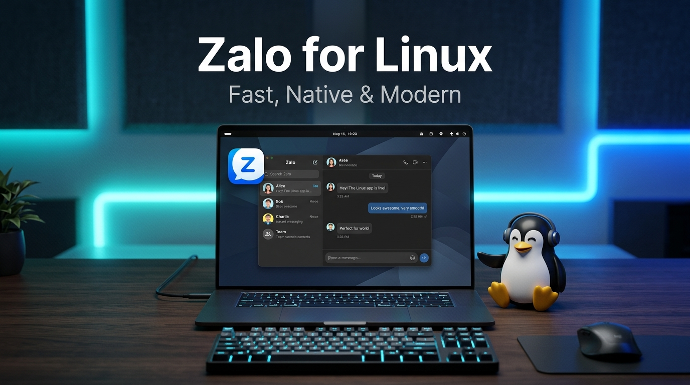

# Zalo for Linux (Unofficial) – Zalo trên Linux

<p align="center">
  <a href="#tiếng-việt"><b>🇻🇳 Tiếng Việt</b></a> | <a href="#english"><b>🇬🇧 English</b></a>
</p>

<p align="center">
  
</p>

---

<a id="tiếng-việt"></a>
## 🇻🇳 Tiếng Việt

**Zalo for Linux** là dự án cộng đồng mang ứng dụng nhắn tin phổ biến hàng đầu Việt Nam – **Zalo trên Linux**. Đây là **bản port từ macOS** (client desktop thực thụ, không phải web wrapper), vận hành trên môi trường runtime **Electron** 22.3.27 và cung cấp sẵn định dạng đóng gói độc lập **AppImage** giúp người dùng cài đặt và khởi chạy nhanh chóng trên các bản phân phối Linux.

> ⚠️ **Đang phát triển (Work in Progress)**: Dự án đang trong quá trình phát triển tích cực. Tính năng gọi thoại và gọi video hiện chưa được hỗ trợ.

### Mục lục
- [Cách thức hoạt động](#cách-thức-hoạt-động)
- [Cài đặt](#cài-đặt)
- [Cách sử dụng](#cách-sử-dụng)
- [Môi trường hỗ trợ](#môi-trường-hỗ-trợ)
- [Tính năng chưa hỗ trợ & Hạn chế đã biết](#tính-năng-chưa-hỗ-trợ--hạn-chế-đã-biết)
- [Trạng thái các Module chi tiết](#trạng-thái-các-module-chi-tiết)
- [Câu hỏi thường gặp (FAQ)](#câu-hỏi-thường-gặp-faq)
- [Đóng góp (Contributing)](#đóng-góp-contributing)
- [Tuyên bố miễn trừ trách nhiệm (Disclaimer)](#tuyên-bố-miễn-trừ-trách-nhiệm-disclaimer)

---

### Cách thức hoạt động

Đây là bản chuyển đổi (port) không chính thức của **Zalo macOS desktop client** sang Linux — hoàn toàn không phải bản bọc web (web wrapper).

Quy trình port được thực hiện bằng cách:
1. Trích xuất file `.dmg` từ bản Zalo chính thức dành cho macOS.
2. Tìm gói `app.asar` tại đường dẫn `/Applications/Zalo.app/Contents/Resources/`.
3. Giải nén bằng lệnh: `asar extract app.asar app`.
4. Vận hành mã nguồn đã giải nén với Electron 22.3.27 (`electron .`).

> **Lưu ý:** Các phiên bản Electron mới hơn sẽ phát sinh lỗi — bắt buộc phải sử dụng Electron v22.3.27.

---

### Cài đặt

#### Cách 1: Sử dụng Script cài đặt tự động
1. **Clone repository**:
   ```bash
   git clone https://github.com/Nhatgreen/Zalo-for-linux.git
   cd Zalo-for-linux
   ```
2. **Chạy script cài đặt**:
   ```bash
   ./install.sh
   ```

#### Cách 2: Sử dụng gói AppImage (Khuyên dùng)
Tải file AppImage mới nhất từ trang [Releases](https://github.com/Nhatgreen/Zalo-for-linux/releases/latest), sau đó phân quyền thực thi và khởi chạy:
```bash
chmod +x Zalo-*.AppImage
./Zalo-*.AppImage
```
*Không cần cài đặt thêm dependency — gói AppImage chạy độc lập hoàn toàn.*

#### Tự đóng gói AppImage
Nếu bạn muốn tự build gói AppImage từ mã nguồn:
```bash
git clone https://github.com/Nhatgreen/Zalo-for-linux.git
cd Zalo-for-linux
./build-appimage.sh
# Kết quả xuất ra tại: dist/Zalo-<version>-x86_64.AppImage
```
*Yêu cầu hệ thống có sẵn: `wget`, `unzip`.*

---

### Cách sử dụng

* **Khởi chạy ứng dụng**:
  - Mở biểu tượng Zalo từ Application Launcher / Desktop Menu của hệ thống.
  - Hoặc khởi chạy thủ công từ terminal:
    ```bash
    ./start.sh
    ```

* **Cập nhật ứng dụng**:
  - Cập nhật thông qua menu hoặc shortcut của ứng dụng.
  - Hoặc chạy thủ công script cập nhật:
    ```bash
    ./update.sh
    ```

---

### Môi trường hỗ trợ

Dưới đây là các thông tin về môi trường phần cứng và hệ điều hành:

- **Kiến trúc phần cứng (Architecture)**: `x86_64` (Intel/AMD 64-bit).
- **Hệ điều hành đã tích hợp script**: 
  - Ubuntu / Debian (Script `start.sh` tự động cấu hình cờ `--no-sandbox` tương thích).
  - Các bản phân phối khác (Arch Linux, Fedora, Linux Mint, openSUSE,...): `[cần tôi điền]`
- **Display Server**:
  - X11: Hoạt động ổn định.
  - Wayland: `[cần tôi điền]`
- **Môi trường Desktop (DE)**: GNOME, KDE Plasma, XFCE: `[cần tôi điền]`

---

### Tính năng chưa hỗ trợ & Hạn chế đã biết

Do sự khác biệt sâu giữa nhân macOS (Mach-O) và Linux (ELF), một số native module chưa được chuyển đổi:

- ❌ **Gọi thoại và gọi video (`zcall`)**: Chưa hỗ trợ. Module cuộc gọi phụ thuộc vào VoIP/WebRTC stack độc quyền với mã hóa ZRTP viết riêng cho macOS.
- ❌ **Xem định dạng ảnh JPEG-XL (`zjxl`)**: Chưa hỗ trợ (yêu cầu bộ thư viện dynamic library liên kết của macOS).
- ❌ **Xử lý ảnh nâng cao (`zimage`)**: Chưa hỗ trợ thumbnail resizing chuyên sâu.
- ❌ **Tạo thumbnail video MP4 (`mp4thumb`)**: Chưa hỗ trợ.
- ❌ **Các tiện ích hệ thống tệp bổ trợ (`file-utilities`, `zwalker`, `file-utils`, `zfile`)**: Hiện đang ở trạng thái stub hoặc chưa hỗ trợ.

---

### Trạng thái các Module chi tiết

#### `zcall` (Gọi thoại & Video)
- **Trạng thái:** ❌ Chưa hỗ trợ (Stubbed)
- **Mô tả:** Stack VoIP và WebRTC độc quyền đồ sộ xây dựng trên mã hóa ZRTP tùy chỉnh. Được hiện thực qua `zcall_mac.node`, đảm nhiệm toàn bộ tính năng gọi thoại và video.

#### `db-cross-v4` (Engine giải mã sao lưu)
- **Trạng thái:** ✅ Đã hỗ trợ
- **Mô tả:** Thay thế binary Mach-O gốc của macOS. Can thiệp vào các tiến trình phục hồi sao lưu để giải nén và giải mã các file sao lưu ZDB4.0 bằng AES-256-CBC và LZMA2, hỗ trợ phục hồi lịch sử tin nhắn trọn vẹn.
- **Hiện thực:** Đã reverse-engineered và viết lại hoàn toàn bằng C++. Bản build cho Linux đã hoàn tất và đang hoạt động ổn định.

#### `zjxl` (Bộ giải mã ảnh JPEG-XL)
- **Trạng thái:** ❌ Chưa hỗ trợ
- **Mô tả:** Chịu trách nhiệm giải mã các file ảnh định dạng JPEG-XL. Phụ thuộc vào hệ sinh thái thư viện động đặc thù của macOS (OpenCV, `highway`, `brotli`).

#### `zimage` (Xử lý hình ảnh nâng cao)
- **Trạng thái:** ❌ Chưa hỗ trợ
- **Mô tả:** Thực hiện các thao tác xử lý ảnh nặng như tạo thumbnail, resize và chuyển đổi ảnh bằng thư viện `libvips-cpp`.

#### `mp4thumb` (Tạo Thumbnail cho Video)
- **Trạng thái:** ❌ Chưa hỗ trợ
- **Mô tả:** Tạo thumbnail từ các tệp video đính kèm `.mp4`. Là native wrapper bao quanh FFmpeg được liên kết tĩnh trên macOS.

#### `file-utilities` (Tính dung lượng thư mục nhanh)
- **Trạng thái:** ❌ Chưa hỗ trợ (Throws Error)
- **Mô tả:** Module Rust NAPI-RS dùng để tính toán đệ quy kích thước thư mục tốc độ cao.

#### `zwalker` (Quét thư mục đệ quy)
- **Trạng thái:** ❌ Chưa hỗ trợ (Stubbed)
- **Mô tả:** Duyệt cây thư mục hệ thống để định vị tệp tin, lập chỉ mục nội dung và phát hiện các bản sao lưu.

#### `file-utils` (Tiện ích tệp tin cấp thấp)
- **Trạng thái:** ❌ Chưa hỗ trợ (Returns "not support")
- **Mô tả:** Cung cấp wrapper native quanh các tác vụ filesystem thông thường (di chuyển, sao chép, thao tác tệp).

#### `v8-profiles` (CPU Profiling)
- **Trạng thái:** ❌ Chưa hỗ trợ
- **Mô tả:** Module profiling đặc thù của macOS dùng để phân tích hiệu năng V8 JavaScript engine.

#### `zfile` (Thông tin ổ đĩa)
- **Trạng thái:** ❌ Chưa hỗ trợ (Stubbed)
- **Mô tả:** Lấy thông tin dung lượng ổ đĩa, thống kê bộ nhớ đã dùng và vùng trống khả dụng.

#### `sqlite3` (Engine cơ sở dữ liệu cục bộ)
- **Trạng thái:** ✅ Đã hỗ trợ
- **Mô tả:** Database engine native dùng để truy xuất các database shard tin nhắn nội bộ (`.db`).
- **Hiện thực:** Binary Mach-O gốc đã được thay thế bằng bản build Linux ELF chuẩn (`node_sqlite3.node`) đi kèm ứng dụng. Hoạt động ổn định hoàn toàn.

#### `zaloLogger` (Ghi log qua IPC)
- **Trạng thái:** ✅ Đã hỗ trợ
- **Mô tả:** Hệ thống ghi log tùy chỉnh thông qua tầng IPC transport.
- **Hiện thực:** Viết hoàn toàn bằng JavaScript đa nền tảng, không cần porting mã nguồn native.

---

### Câu hỏi thường gặp (FAQ)

**Q: Zalo for Linux có thể chạy trên những bản phân phối nào?**  
A: Ứng dụng chạy tốt trên hầu hết các bản phân phối Linux phổ biến (Ubuntu, Debian, Fedora, Arch Linux, Linux Mint,...) qua gói AppImage hoặc cài đặt bằng script.

**Q: Tôi có thể gọi điện hoặc gọi video trên bản Zalo Linux này không?**  
A: Hiện tại **chưa thể gọi thoại hoặc video**. Module `zcall` của Zalo sử dụng stack VoIP/ZRTP nhị phân riêng cho macOS chưa được dịch ngược và build lại cho Linux. Tính năng nhắn tin, gửi nhận file, ảnh, sticker hoạt động bình thường.

**Q: Lịch sử tin nhắn của tôi có được lưu trên máy không?**  
A: Có. Ứng dụng tích hợp engine database SQLite native cho Linux (`node_sqlite3.node`) và công cụ khôi phục sao lưu `db-cross-v4` viết lại bằng C++, cho phép lưu trữ và phục hồi tin nhắn trên máy tính của bạn.

**Q: Tại sao phải sử dụng đúng Electron v22.3.27?**  
A: Mã nguồn ứng dụng Zalo desktop phụ thuộc vào API nội bộ và ABI của Node.js / Chromium thuộc nhánh Electron 22. Nâng cấp lên các bản Electron mới hơn sẽ gây lỗi tương thích runtime.

**Q: Dự án này có phải của công ty VNG phát hành không?**  
A: **Không.** Đây là dự án nguồn mở độc lập do cộng đồng phát triển và duy trì, hoàn toàn không có mối liên kết hay tài trợ chính thức nào từ VNG Corporation.

---

### Đóng góp (Contributing)

Dự án luôn hoan nghênh sự đóng góp từ cộng đồng (đặc biệt là việc reverse engineering các native module còn thiếu):
1. Fork repository
2. Tạo nhánh tính năng (`git checkout -b feature/tinh-nang-moi`)
3. Commit thay đổi (`git commit -m 'Add: mô tả tính năng'`)
4. Push lên nhánh của bạn (`git push origin feature/tinh-nang-moi`)
5. Tạo Pull Request

---

### Tuyên bố miễn trừ trách nhiệm (Disclaimer)

⚠️ **Đây là bản port do cộng đồng phát triển và KHÔNG có bất kỳ liên kết, bảo trợ hay hợp tác chính thức nào với Zalo hay VNG Corporation.** Mọi nhãn hiệu hàng hóa và bản quyền thuộc về chủ sở hữu tương ứng.

---

### Hỗ trợ & Báo lỗi (Support)

Nếu gặp sự cố, có câu hỏi hoặc đề xuất giải pháp, vui lòng mở issue tại trang [GitHub Issues](https://github.com/Nhatgreen/Zalo-for-linux/issues).

---

<br />

<a id="english"></a>
## 🇬🇧 English

**Zalo for Linux** is an open-source community project bringing Vietnam's premier messaging platform – **Zalo on Linux**. This is an **unofficial port of the Zalo macOS desktop client** (a real desktop client, not a web wrapper), running on the **Electron** 22.3.27 runtime and conveniently distributed as a standalone **AppImage** package or automated setup script for Linux users.

> ⚠️ **Work in Progress**: This project is under active development. Voice and video calling functionality are not supported yet.

### Table of Contents
- [How It Works](#how-it-works)
- [Installation](#installation)
- [Usage](#usage)
- [Supported Environments](#supported-environments)
- [Known Limitations & Issues](#known-limitations--issues)
- [Native Module Status](#native-module-status)
- [FAQ](#faq)
- [Contributing](#contributing)
- [Disclaimer](#disclaimer)

---

### How It Works

This is an unofficial port of the **Zalo macOS desktop client** to Linux — not a web wrapper. Calls are not supported yet.

The port was created by:
1. Extracting the `.dmg` from the official macOS release.
2. Locating `app.asar` at `/Applications/Zalo.app/Contents/Resources/`.
3. Extracting it using `asar extract app.asar app`.
4. Running the extracted application with Electron 22.3.27 (`electron .`).

> **Note:** Newer versions of Electron cause runtime incompatibility errors — v22.3.27 is strictly required.

---

### Installation

#### Option 1: Automated Install Script
1. **Clone the repository**:
   ```bash
   git clone https://github.com/Nhatgreen/Zalo-for-linux.git
   cd Zalo-for-linux
   ```
2. **Run the install script**:
   ```bash
   ./install.sh
   ```

#### Option 2: AppImage (Recommended)
Download the latest AppImage from the [Releases](https://github.com/Nhatgreen/Zalo-for-linux/releases/latest) page, make it executable, and run:
```bash
chmod +x Zalo-*.AppImage
./Zalo-*.AppImage
```
*No external dependencies required — fully self-contained.*

#### Building the AppImage yourself
To package the AppImage yourself from source:
```bash
git clone https://github.com/Nhatgreen/Zalo-for-linux.git
cd Zalo-for-linux
./build-appimage.sh
# Output binary: dist/Zalo-<version>-x86_64.AppImage
```
*Requirements: `wget`, `unzip`.*

---

### Usage

* **Launch the application**:
  - Open Zalo from your desktop application launcher / menu.
  - Or launch manually from terminal:
    ```bash
    ./start.sh
    ```

* **Update the application**:
  - Update via the desktop menu or launcher.
  - Or manually run the update script:
    ```bash
    ./update.sh
    ```

---

### Supported Environments

- **Architecture**: `x86_64` (64-bit Intel/AMD).
- **Distributions with built-in script support**:
  - Ubuntu / Debian (The `start.sh` script automatically sets `--no-sandbox` flag).
  - Other distributions (Arch Linux, Fedora, Linux Mint, openSUSE,...): `[cần tôi điền]`
- **Display Server**:
  - X11: Stable.
  - Wayland: `[cần tôi điền]`
- **Desktop Environments**: GNOME, KDE Plasma, XFCE: `[cần tôi điền]`

---

### Known Limitations & Issues

Due to platform differences between macOS (Mach-O) and Linux (ELF), certain proprietary native modules remain unported:

- ❌ **Audio & Video Calling (`zcall`)**: Unported. The proprietary VoIP/WebRTC stack with custom ZRTP encryption is compiled exclusively for macOS.
- ❌ **JPEG-XL Image Decoding (`zjxl`)**: Unported (requires macOS dynamic libraries).
- ❌ **Advanced Image Processing (`zimage`)**: Unported thumbnail transformations.
- ❌ **MP4 Video Thumbnails (`mp4thumb`)**: Unported macOS FFmpeg wrapper.
- ❌ **Filesystem Utilities (`file-utilities`, `zwalker`, `file-utils`, `zfile`)**: Currently stubbed or unsupported.

---

### Native Module Status

#### `zcall` (Audio & Video Calling)
- **Status:** ❌ Unported (Stubbed)
- **Description:** A massive proprietary VoIP and WebRTC stack built around custom ZRTP-based encryption. Implemented through `zcall_mac.node` and responsible for all voice and video calling functionality.

#### `db-cross-v4` (Backup Decryption Engine)
- **Status:** ✅ Ported
- **Description:** Replaces the original macOS Mach-O binary. Intercepts backup restoration calls to decompress and decrypt proprietary ZDB4.0 backup containers using AES-256-CBC and LZMA2, enabling full chat history recovery.
- **State:** Fully reverse-engineered and reimplemented in C++. The Linux replacement is complete and currently active.

#### `zjxl` (JPEG-XL Codec Support)
- **Status:** ❌ Unported
- **Description:** Responsible for decoding JPEG-XL image files. Depends on a large bundled ecosystem of macOS-specific dynamic libraries, including OpenCV, `highway`, and `brotli`.

#### `zimage` (Advanced Image Processing)
- **Status:** ❌ Unported
- **Description:** Performs computationally intensive image operations such as thumbnail generation, resizing, and image transformations using the bundled `libvips-cpp` library.

#### `mp4thumb` (Video Thumbnail Generation)
- **Status:** ❌ Unported
- **Description:** Generates image thumbnails from `.mp4` attachments. Functions as a native macOS wrapper around a statically linked FFmpeg component that extracts preview frames.

#### `file-utilities` (Fast Directory Sizing)
- **Status:** ❌ Unported (Throws Error)
- **Description:** A Rust-based NAPI-RS module used for high-performance recursive directory size calculations.

#### `zwalker` (Recursive Directory Scanner)
- **Status:** ❌ Unported (Stubbed)
- **Description:** Traverses the filesystem to locate files, index content, and discover backups.

#### `file-utils` (Low-Level File System Utilities)
- **Status:** ❌ Unported (Returns "not support")
- **Description:** Provides native wrappers around common filesystem operations such as moving, copying, and manipulating files.

#### `v8-profiles` (CPU Profiling)
- **Status:** ❌ Unported
- **Description:** A macOS-specific profiling module used to analyze V8 JavaScript engine performance.

#### `zfile` (Disk Information)
- **Status:** ❌ Unported (Stubbed)
- **Description:** Retrieves disk usage statistics, storage capacity information, and available free space.

#### `sqlite3` (Local Database Engine)
- **Status:** ✅ Supported
- **Description:** The native database engine used to access local message shard databases (`.db` files).
- **State:** The original macOS binary has been replaced with a Linux ELF build (`node_sqlite3.node`) bundled within the application. Functionality is fully operational.

#### `zaloLogger` (IPC Logging)
- **Status:** ✅ Supported
- **Description:** Custom logging infrastructure utilizing an IPC transport layer.
- **State:** Implemented entirely in cross-platform JavaScript and requires no platform-specific porting work.

---

### FAQ

**Q: Can Zalo run on Linux?**  
A: Yes! Through this Electron-based port, the Zalo macOS desktop client runs reliably on Linux via AppImage or manual installation.

**Q: Can I make audio and video calls on Zalo for Linux?**  
A: Not yet. The `zcall` VoIP stack is a proprietary macOS-specific binary. Text messaging, file transfer, sticker, and media sharing work smoothly.

**Q: Are chat history and local databases supported?**  
A: Yes. Local message databases are powered by a native Linux `sqlite3` driver, and backup restoration is supported via our custom C++ `db-cross-v4` engine.

**Q: Why is Electron v22.3.27 required?**  
A: The application's bundled components and Node.js ABI bindings depend specifically on Electron 22. Upgrading to newer Electron versions causes runtime breakage.

**Q: Is this client officially endorsed by VNG?**  
A: No. This is an unofficial, community-driven open-source port and is not affiliated with or supported by VNG Corporation.

---

### Contributing

Contributions are welcome, especially for reverse engineering the remaining native macOS modules:
1. Fork the repository
2. Create a feature branch (`git checkout -b feature/your-feature`)
3. Commit your changes (`git commit -m 'Add your feature'`)
4. Push to the branch (`git push origin feature/your-feature`)
5. Open a Pull Request

---

### Disclaimer

⚠️ **This is a community port and is not officially affiliated with Zalo or VNG Corporation.** All trademarks and copyrights belong to their respective owners.

---

### Support

For issues, questions, or suggestions, please open an issue on the [GitHub Issues](https://github.com/Nhatgreen/Zalo-for-linux/issues) page.
